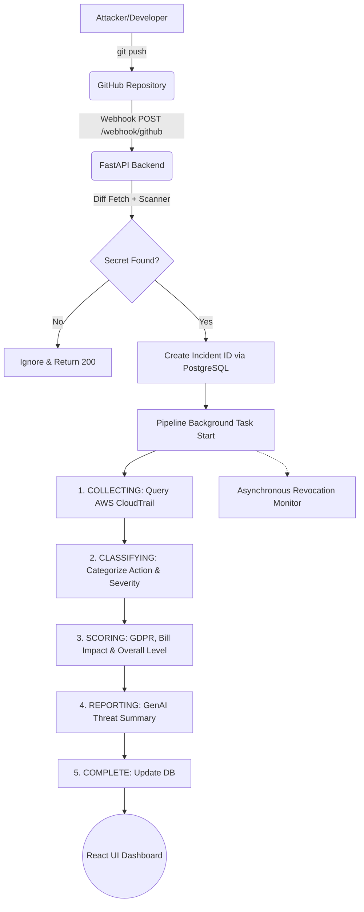

# BreachTrace — Pipeline & Completed Functional Requirements

## 1. Completed Functional Requirements

### Detection & Webhook Integration
- **GitHub Webhook Listener:** Automatically receives `push` event payloads directly from GitHub.
- **Diff Parsing & Extraction:** Fetches the unified diff from the GitHub API and reliably filters out unchanged context (`@@` lines), ensuring only *newly added* code is scanned.
- **Regex-based Secret Scanner:** Identifies `AWS_ACCESS_KEY_ID` (AKIA...) and proximity-based Secret Access Keys in newly committed lines.
- **Exposure Window Tracking:** Accurately timestamps the moment of the leak (commit timestamp) for forensic analysis.

### Data Collection & Forensics
- **AWS CloudTrail Collector:** Dynamically queries `LookupEvents` using the admin AWS key.
- **Temporal Lookback:** Automatically pulls events spanning from 120 minutes *before* the commit exposure start time, capturing any reconnaissance the attacker did before committing the leaked key.
- **Automated Revocation Monitor:** Operates as an asynchronous background worker polling AWS STS every minute (up to 10 minutes) to pinpoint the exact second a leaked key’s access is shut off.

### Classification & Scoring Engine
- **Event Classifier:** Inspects raw API calls (e.g., `s3.amazonaws.com`, `sts.amazonaws.com`) and classifies behavior into impact categories: `reconnaissance` (Low), `data_access` (Medium), `exfiltration` (High/Critical).
- **Incident Scorer:** Aggregates weighted event severities to assign an overall incident severity (`LOW`, `MEDIUM`, `HIGH`, `CRITICAL`).
- **GDPR / PII Flagging:** Scans resource names or API requests for hints of user data or PII, triggering immediate legal compliance warnings.
- **Financial Impact Algorithm:** Recognizes resource-intensive API calls (like EC2 `RunInstances`) and flags potential billing spikes.

### Intelligence & Generative AI Reporting
- **Gemini LLM Integration:** Synthesizes raw JSON logs containing source IPs, APIs, and Categories into a human-readable summary.
- **Four-Part Forensic Report:** Automatically outputs:
  1. Executive Summary
  2. Chronological Narrative
  3. Business Impact Assessment
  4. Actionable Remediation Checklist (with explicit reference to affected cloud resources).

### Interactive Dashboard (Frontend)
- **Real-Time Pipeline Stepper:** Visually maps incident processing states (`detecting` → `collecting` → `classifying` → `scoring` → `reporting` → `complete`).
- **Live Sync:** Dashboard polls incidents and dynamically updates state without manual refreshes.
- **Forensic Visualization:** D3-powered interactive timeline grouping events by service/time, offering hover tooltips.
- **Blast Radius Analytics:** Progress bars mapping reconnaissance vs. data access vs. exfiltration events.

---

## 2. End-to-End Pipeline Flow

---

## 3. Demonstration Flow

1. **Pre-Demo Preparation:** 
   - Approximately 20 minutes before the demo, a sequence of AWS API calls (`aws s3 ls`, `aws ec2 describe-instances`) is made using the simulated exposed AWS Experiment credentials. This builds actual AWS CloudTrail activity logs.
2. **Backend & Frontend Initialization:** 
   - `uvicorn` spins up the Python backend, `ngrok` establishes the secure webhook tunnel, and `vite` serves the React frontend.
3. **Webhook Submittal:** 
   - You push the specific credentials in a real `git push` to your repository, firing the GitHub webhook.
4. **Live Dashboard Update (Real-time tracking):** 
   - An incident record spontaneously appears on the frontend dashboard.
5. **Observation of the Pipeline Steps:** 
   - You click the record and watch the top-right progress stepper light up as it sequentially queries AWS, scores records, and reaches out to Google Gemini.
6. **Detailed Analysis Presentation:** 
   - Evaluators observe the fully generated Forensic Timeline, the Severity Badges, the GDPR warnings (if applicable), and the LLM-derived Executive Summary / Checklists.
