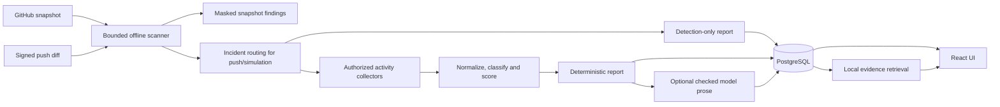

# BreachTrace

BreachTrace is a research prototype for finding credential candidates in GitHub repositories and reviewing available incident evidence. It combines cloud/SaaS pattern detection, **49 AI credential families**, bounded static obfuscation recovery, optional authorized activity collection, deterministic reports, selectable report models and local evidence search.

Each installation supports one organisation with multiple projects. Administrators and security leads have organisation-wide search, research and snapshot scan access; developers access their assigned projects and cannot use those organisation-wide features. The selected project does not filter organisation-wide results.

A detected pattern is **not proof of a valid key or a breach**. Detection-only findings have no assessed activity or severity. Public repository scans never start provider collection automatically.

- [Research paper reference: abstract, architecture, methodology and results](docs/research/paper-reference.md)
- [AI coverage and limitations](docs/ai-detection.md)
- [Six synthetic AI examples](docs/ai-ui-demo.md)
- [Local testing guide](docs/local-testing.md)
- [Logic and migration review](docs/logic-review.md)

## What is implemented

- **Existing repository scans:** paste an HTTPS GitHub repository root URL in Connect. The backend pins the default branch to a commit, downloads its archive and scans eligible text files without executing repository code. Webhook registration is optional. Private repositories require configured GitHub access.
- **Push detection:** signed GitHub push webhooks scan added/unchanged source, exclude deleted material and isolate unrelated files/hunks. Findings retain input-diff line provenance.
- **AI candidates:** OpenAI/GPT, Anthropic/Claude, Gemini, DeepSeek, Sarvam, Groq and other registered services. Nine families have distinctive-prefix rules; the rest require provider-specific credential fields or context. A generic Google API key is not automatically labelled Gemini.
- **Static recovery:** Base64/Base64URL, hex, Unicode/hex escapes, percent encoding, HTML entities, zero-width characters, static literal concatenation/joins, reversed literals and explicit ROT13. Work limits are disclosed; arbitrary encryption, runtime data flow and cross-file assembly are unsupported.
- **Forensic pipeline:** authorized collectors, normalized events, eight impact categories, rule-based severity and financial-impact summaries. Five collector adapters serve AWS, GCP, Azure, Stripe and Twilio; Firebase service-account findings reuse GCP.
- **Reports and search:** deterministic reports work without a model; optional model-written report prose passes grounding checks before replacing template prose. Search retrieves incidents, reports, knowledge passages and timestamped events. Users can explicitly request a concise model answer grounded in the retrieved passages; citations remain visible, and cloud generation sends the question and passages to the selected provider.
- **UI:** Monitor, incident detail, Search, Research, Connect and Settings, with explicit detection-only and synthetic-demo states.

**Stack:** Python/FastAPI, SQLAlchemy/Alembic, PostgreSQL, React/TypeScript, Vite, Tailwind, D3, BM25 and optional FastEmbed embeddings.

## Architecture



Snapshot scanning is a current-code review: candidates appear in Connect and do not create Monitor incidents or start provider collection. It does not scan Git history or establish when a credential was first exposed. Register a webhook separately to monitor future pushes. An incident's `complete` status means processing finished; it does not confirm remediation or revocation.

## Run the isolated local demo

Prerequisites: **Python 3.12+**, **Node.js 20.19+ or 22.12+** (Vite requirement), npm, and Docker Desktop with Compose running. No Azure, AWS, Twilio or AI-provider account is needed for this demo. Commands below run from the repository root.

```sh
python3.12 -m venv .venv
.venv/bin/pip install -r backend/requirements.txt -r backend/requirements-dev.txt
npm --prefix client ci
.venv/bin/python scripts/local_dev.py prepare

docker compose --project-name breachtrace-local-test --env-file .env.testing.local -f docker-compose.local.yml up -d --wait db
.venv/bin/python scripts/local_dev.py bootstrap
.venv/bin/python scripts/seed_ai_demos.py
```

`prepare` preserves an existing `.env.testing.local`; a new profile contains generated local passwords and empty cloud credentials. The database is `breachtrace_local_test` at `127.0.0.1:55432`, in a separate Docker volume. `bootstrap` creates the ORM schema only in that named test database; it does not migrate or stamp an existing application database.

Start these in **separate terminals**:

```sh
.venv/bin/python scripts/local_dev.py backend
```

```sh
.venv/bin/python scripts/local_dev.py frontend
```

Open:

- UI: http://127.0.0.1:5173
- AI examples: http://127.0.0.1:5173/?platform=ai
- API docs: http://127.0.0.1:8000/docs

The six new AI examples cover OpenAI, Claude, Gemini, DeepSeek, Sarvam and Groq, including encoded and split strings. They use fabricated credentials and create no research experiment rows. Click a masked key to inspect the report. Additional synthetic verification incidents may also be present.

Embedding search may download its embedding model on first enabled use. For keyword-only operation, set `EMBED_ENABLED=false` in `.env.testing.local` before bootstrap/startup. No generative report model is downloaded automatically.

### Frontend-only preview

Use this instead of the live frontend command when no backend/database is wanted:

```sh
VITE_USE_MOCK=true npm --prefix client run dev -- --host 127.0.0.1 --port 5173 --strictPort
```

Preview incidents and research metrics are synthetic. Repository scanning and model settings require a backend. Live mode is selected by `scripts/local_dev.py frontend`; for a manual Vite launch, set `VITE_USE_MOCK=false` and `VITE_API_URL=http://127.0.0.1:8000` in `client/.env.local`.

## Detection versus forensic coverage

| Credential/service | Current collection route | Important limit |
|---|---|---|
| AWS access-key ID | CloudTrail lookup | Available management events; not complete data-plane visibility |
| GCP service account / Firebase admin account | Cloud Audit Logs | Identity-based; depends on available/enabled logs |
| Azure service principal | Activity Log | Control-plane evidence; a secret without a client ID is detection-only |
| Stripe secret/restricted key | Account Events API; optional Stripe CLI sandbox request stream | Events are account-wide state changes; the CLI stream captures new sandbox requests including GETs, but not live mode or per-key attribution |
| Twilio account / API key | Outbound Message/Call resources and supported Monitor Events | Account activity is not proof of use by a particular key; reads and other activity may be absent |
| AI credentials, GitHub/Slack/npm/SendGrid/Hugging Face/database candidates | Detection-only | No activity collection implemented for these findings |

Provider access, permissions, retention, latency, logging configuration and collector limits constrain every reconstruction. Collectors request up to 30 days of recent history through collection time. Events before detected exposure appear as context; severity, impact and report calculations use activity at or after detected exposure. Collection is not a guarantee that all actions or misuse can be identified.

The triggering commit time is an estimated exposure start. Ordinary incidents do not automatically confirm rotation, and records can be associated with an account or application rather than an individual key. See [exposure and attribution scope](docs/exposure-attribution.md).

Project incidents use their project's verified provider wallet reader for collection and refresh. Configure a Stripe Events reader for the same account and live/test mode in the project's wallet; collection does not fall back to a global key if the connection is missing or unavailable. Legacy incidents without a project retain environment-based readers. The optional `stripe-request-logs` Docker sidecar streams new sandbox API requests, including GETs, into an incident; it runs persistently alongside the backend and can be deployed on an always-on host. It cannot backfill old requests, stream live-mode logs, or identify which account key caused a request. See [Stripe request stream setup](docs/stripe-request-stream.md). Stripe event snapshots are reduced to identifiers and financial fields before storage. Existing codebase snapshot scans report candidates but do not start cloud forensics.

Repository scans cover the **current snapshot**, not Git history, submodule contents or binaries. Defaults: 10 MiB/file, 1 GiB scanned text, 200,000 files, 10,000 findings, a 2 GiB archive download limit and a 10-minute scan timeout. Downloading an archive is capped at 5 minutes. Exclusions and decoding limits are reported. See [coverage details](docs/ai-detection.md).

## Reports and model settings

Settings supports deterministic reports, OpenAI, Anthropic, Gemini, local Ollama and a user-selected GGUF file. Cloud generation sends incident fact sheets to the selected provider and may incur usage charges. Local models run on the backend machine. Entered API keys stay in one backend process's memory; preferences are stored under `data/`. Environment keys are also supported.

- OpenAI/Anthropic adapters use the existing HTTP dependency.
- Gemini requires the optional `google-genai` package in the backend environment.
- Ollama requires a running local service and an already-installed model.
- GGUF support requires `backend/requirements-local.txt`, an existing model file and its applicable quality-gate manifest. Training/distillation/evaluation utilities exist in `backend/research/`; a trained, validated BreachTrace model is **not bundled or claimed as completed**.

The report prose validator checks selected identifiers, amounts, counts and unsupported activity expressions. It is **not a proof of semantic correctness**. Severity, checklist generation and financial calculations remain deterministic; users must review evidence. Search answers are also model-written only when explicitly requested; their citations link to retrieved passages but do not prove every generated statement. Cloud answer generation sends the submitted question and selected passages to the configured provider.

## Verification and research evidence

Verification recorded on **2026-11-04 (Asia/Kolkata)**:

- Backend: **1,250 passed, 2 skipped**; existing deprecation/async-test warnings remain.
- Frontend: presentation/component checks, production build and lint passed; the bundle-size advisory remains.
- Current keyword retrieval fixture: **40/43 queries hit an acceptable passage in the top five (93.0%)**. This is query hit rate, not secret-detection recall or LLM factual accuracy.
- Sequential current-detector scans, historical scan observations, the four-case local-model pilot and their limitations are recorded in the [paper reference](docs/research/paper-reference.md) and its [portable evidence summary](docs/research/evidence/measured-results.json).
- Six AI demo details, named-provider searches and desktop UI flows were verified. Demos and tests do not establish real-world precision/recall. SecretBench's labelled data is not present in this workspace.

Run checks from the root:

```sh
.venv/bin/python -m pytest backend/tests -q
npm --prefix client test
npm --prefix client run build
npm --prefix client run lint
PYTHONPATH=backend DATABASE_URL=sqlite:// EMBED_ENABLED=false .venv/bin/python -m rag.evaluate
```

Separate live checks for the isolated profile:

```sh
.venv/bin/python scripts/smoke_local.py
.venv/bin/python scripts/check_migrations.py
```

The smoke script creates a synthetic detection, briefly tests an installed local Ollama model and scans a public repository. Migration checks create/drop only newly generated disposable databases on the isolated local server. See [migration scope and rollback behavior](docs/logic-review.md).

## Authorized provider/webhook setup

For an account-backed installation, use `.env.example` as a template without overwriting existing configuration. The standard profile currently validates AWS, experiment and GitHub settings listed in `backend/config.py`; the isolated test profile bypasses those requirements. `GITHUB_TOKEN` authorizes GitHub API access, while `GITHUB_WEBHOOK_SECRET` independently verifies incoming webhook signatures. A GitHub token is not the webhook signing secret.

| Configuration | Purpose |
|---|---|
| `DATABASE_URL` | Application database |
| `GITHUB_TOKEN`, `GITHUB_WEBHOOK_SECRET`, `GITHUB_TEST_REPO` | Repository API access, signed pushes, experiment repository |
| `AWS_ACCESS_KEY_ID`, `AWS_SECRET_ACCESS_KEY`, `AWS_REGION` | Authorized CloudTrail access |
| `GCP_PROJECT_ID`, `GCP_SERVICE_ACCOUNT_JSON` | Authorized GCP log access |
| `AZURE_TENANT_ID`, `AZURE_CLIENT_ID`, `AZURE_CLIENT_SECRET`, `AZURE_SUBSCRIPTION_ID` | Authorized Azure log access |
| `STRIPE_API_KEY`, `TWILIO_ACCOUNT_SID`, `TWILIO_AUTH_TOKEN` | Authorized SaaS access; collector-specific scope applies |
| `TWILIO_API_KEY_SID`, `TWILIO_API_KEY_SECRET` | Alternative Twilio reader credentials; require the owning `TWILIO_ACCOUNT_SID` |
| `OPENAI_API_KEY`, `ANTHROPIC_API_KEY`, `GEMINI_API_KEY` | Optional report-generation credentials; not needed to detect these key types |
| `REPORT_PROVIDER`, `MODEL_SETTINGS_FILE`, `EMBED_ENABLED`, `MODEL_CACHE_DIR` | Reporting/search preferences and storage |

For a **fresh, separately provisioned application database**, after reviewing the [migration notes](docs/logic-review.md), run from `backend/`:

```sh
../.venv/bin/alembic upgrade head
```

Start the standard backend from `backend/` with `../.venv/bin/uvicorn main:app --host 127.0.0.1 --port 8000`. Optional webhook delivery requires a reachable HTTPS endpoint and appropriate GitHub permissions; Connect contains registration/manual instructions. Do not infer an existing schema's migration state from the local demo database.

This is a local research application, not a hardened multi-tenant service. Settings and repository scans require a loopback operator connection; the broader API still needs deployment authentication/authorization. Snapshot jobs and entered model keys are process-local, scans are serialized, and background tasks are not a durable queue.

### Twilio collection

For project incidents, add the owning account's `AC...` SID and a reader API key or Auth Token to the project wallet and wait for verification. The reader needs access to Messages, Calls and Monitor Events for that account. Unassigned legacy incidents use `TWILIO_ACCOUNT_SID` and the corresponding API key or Auth Token in the backend environment. If a detected API key has no unambiguous Account SID nearby, its incident stays detection-only until the operator supplies the owning account on its detail page.

The collector includes outbound messages and calls and supported Monitor Events inside the exposure window, excluding message bodies and Monitor event data. Event histories can include legitimate activity, do not establish key validity or attribution, and are limited by provider permissions, logging and retention. Missing timestamps, cross-account results, permission failures, and more than 5,000 resources of one type cause collection to fail rather than present a partial result as complete. Twilio-reported prices are grouped by currency; missing prices are marked pending. A repository snapshot only reports findings and does not start provider collection.

## Project map

| Path | Responsibility |
|---|---|
| `backend/detector/` | Cloud/SaaS patterns, AI registry, bounded normalization, diff/file/repository scans |
| `backend/repository_snapshot.py` | Pinned GitHub download and constrained extraction |
| `backend/routers/` | Webhooks, simulation, incidents, repositories, search, settings, research APIs |
| `backend/collectors/`, `normalizer/`, `classifier/`, `scorer/` | Authorized evidence collection and deterministic analysis |
| `backend/reporter/`, `llm_client.py`, `model_settings.py` | Fact sheets, templates, selected prose writers and checks |
| `backend/rag/` | Knowledge base, BM25/embedding retrieval, query filters and timestamp lookup |
| `backend/db/`, `migrations/` | Persistence and schema transitions |
| `backend/research/` | Experiment harness, scan/model pilots, report training/evaluation tooling, UI demos |
| `client/src/` | Monitor, detail, Search, Research, Connect, Settings and preview data |
| `scripts/` | Isolated setup, smoke/migration checks and synthetic seeding |
| `docs/research/` | Paper reference, measured evidence, pilot/stress notes and references |
| `data/` | Gitignored local models, scan reports, settings and experiment outputs |

## Team

| Member | Focus |
|---|---|
| Ritwik | FastAPI, webhooks, collectors, database, deployment |
| Shashank | Schema, API specification, taxonomy, severity, paper |
| Yash | Detection rules, classifier, research harness |
| Vedant | React dashboard, timeline, reports, normalization |

**Guide:** Dr. Irfan Siddavatam · K.J. Somaiya College of Engineering
