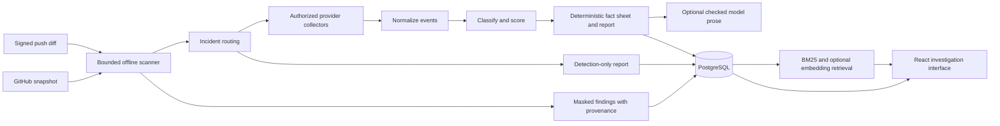

# BreachTrace: Research Paper Reference

## Working Title

**BreachTrace: A Cross-Platform Pipeline for Credential Exposure Detection and Evidence-Aware Incident Reconstruction**

## Abstract

Credential exposure in public source repositories is often treated as a detection problem: identify a suspicious string and notify the owner. Detection alone, however, does not answer the operational questions that follow an exposure: whether the credential could have been used, what activity occurred during the exposure window, what resources were affected, and which remediation actions are appropriate. BreachTrace is a research prototype that combines bounded repository scanning, credential-family classification, static obfuscation recovery, authorized provider activity collection, deterministic incident analysis, and evidence-aware reporting. The system scans pinned GitHub snapshots and signed push diffs without executing repository code. When provider audit APIs are available, it normalizes and classifies activity into impact categories such as reconnaissance, data access, exfiltration, privilege escalation, financial abuse, and communication abuse. A deterministic report is produced independently of optional generative model prose, and the interface explicitly distinguishes detection-only findings from incidents with reconstructed activity.

The current implementation supports cloud, SaaS, and AI credential families, with forensic collection for selected AWS, Google Cloud, Azure, Stripe, and Twilio workflows. On the verification run recorded on 2026-11-04, the backend suite passed 1,250 tests with 2 skipped, while the frontend presentation checks, production build, and lint passed. A keyword retrieval fixture achieved an acceptable top-five passage hit for 40 of 43 queries (93.0%). These figures are engineering verification results rather than claims of real-world secret-detection recall or language-model factual accuracy. Independent labelled secret data was not available in the workspace; therefore, the paper must not present the synthetic fixtures or demonstrations as an empirical precision/recall benchmark.

**Keywords:** secret detection, credential exposure, incident response, cloud forensics, repository scanning, audit logs, security automation, evidence-aware reporting

## 1. Research Problem

Source-code secret scanners usually optimize for finding candidate credentials. Incident-response systems usually begin after a provider alert or confirmed compromise. The gap between these workflows is the central problem addressed by BreachTrace:

> How can a system connect repository-level credential exposure detection with provider-specific evidence collection and transparent incident reconstruction, while preserving the distinction between a syntactic candidate and a confirmed security event?

The problem has three practical constraints:

1. A detected string is not proof that a credential is valid, active, owned by the repository author, or used by an attacker.
2. Auditability differs by platform. Some providers expose useful activity records; others do not expose per-token or per-key activity at all.
3. Generative summaries can improve readability but must not be allowed to invent events, amounts, resources, or severity.

## 2. Research Objectives

The prototype is designed to evaluate the following objectives:

- Detect credential candidates across cloud, SaaS, and AI provider formats in repository snapshots and push diffs.
- Recover bounded, statically encoded representations without executing untrusted repository code.
- Preserve source provenance, including file, line, detection method, and confidence.
- Collect authorized provider evidence within a disclosed time window when an audit API supports it.
- Normalize heterogeneous provider events into a common taxonomy and deterministic severity model.
- Produce useful reports even when forensic reconstruction is unavailable.
- Keep optional model-generated prose subordinate to deterministic facts and remediation logic.
- Make system limitations visible to both investigators and paper readers.

## 3. System Architecture



### 3.1 Components

| Component | Role | Main implementation area |
|---|---|---|
| Repository snapshot scanner | Pins a GitHub default branch to a commit, downloads eligible text files, and applies resource limits | `backend/repository_snapshot.py`, `backend/detector/` |
| Push-diff scanner | Scans added or unchanged post-commit source and excludes deleted material | `backend/detector/scanner.py`, `backend/routers/webhook.py` |
| Credential registry | Describes provider families, prefixes, contextual fields, and confidence rules | `backend/detector/patterns.py`, `backend/detector/ai_keys.py` |
| Static recovery layer | Handles bounded Base64, hex, escapes, percent encoding, entities, joins, reversal, and ROT13 cases | `backend/detector/ai_obfuscation.py` |
| Evidence collectors | Queries authorized provider APIs for activity in a defined collection interval | `backend/collectors/` |
| Normalizer and classifier | Maps provider-specific records to common event fields and impact categories | `backend/normalizer/`, `backend/classifier/` |
| Scorer and reporter | Computes severity, financial/PII indicators, remediation, and deterministic report facts | `backend/scorer/`, `backend/reporter/` |
| Retrieval layer | Retrieves stored incidents, reports, knowledge passages, and timestamped evidence | `backend/rag/` |
| User interface | Displays pipeline state, timelines, blast radius, reports, search, and coverage limitations | `client/src/` |

### 3.2 Forensic Coverage Tiers

The paper should report two separate capabilities:

- **Tier 1: forensic-capable.** The system can detect a credential family and query a provider audit or activity interface, subject to permissions, retention, and provider coverage.
- **Tier 2: detection-only.** The system can identify and classify a candidate, but the provider does not expose sufficient per-credential activity for reconstruction in the supported workflow.

This distinction is a platform property, not a failure of the detector. For example, an AWS access-key candidate may be paired with CloudTrail lookup, while an AI API key or personal token may only support exposure metadata and remediation guidance.

## 4. Methodology

### 4.1 Input and Scope

The scanner accepts either a pinned repository snapshot or a signed push event. Snapshot scans operate on the current default-branch archive rather than full Git history. Push scans use the post-commit added/unchanged source and preserve diff line provenance. Files are scanned as text subject to disclosed limits; binaries, oversized files, excluded directories, symlink traversal, and unsupported archive contents are not treated as ordinary source input.

Default safeguards include a 2 MiB per-file limit, 512 MiB total scanned text, 100,000 files, 10,000 findings, and a 180-second scan timeout. These limits make resource use measurable and prevent the scanner from becoming an unbounded execution surface.

### 4.2 Candidate Detection

Detection combines distinctive prefixes with contextual matching. Context includes named environment variables, provider-specific configuration fields, SDK constructors, endpoints, structured JSON paths, and nearby source lines. Opaque values require credential semantics and entropy rather than length alone. Findings retain a masked value, provider family, confidence, source location, and detection method. Plaintext credential material is not stored in scan results or logs.

The registry currently covers 49 AI credential families in addition to cloud, SaaS, GitHub, database, and messaging candidates. Contextual support means that a provider-specific field can be recognized; it does not mean every vendor-issued key format has been independently validated.

### 4.3 Static Obfuscation Recovery

The recovery layer enumerates bounded static representations, including Base64/Base64URL, hexadecimal, Unicode and hexadecimal escapes, URL percent encoding, HTML entities, zero-width characters, literal concatenation, literal-only joins, reversed literals, and explicitly marked ROT13. It does not evaluate code, import repository modules, resolve arbitrary runtime data flow, decrypt custom ciphers, or assemble values across files. The recovered value is used for matching and then masked.

### 4.4 Evidence Collection

For authorized Tier-1 workflows, the system collects events from the relevant provider API. Collection begins 120 minutes before the exposure start and continues through collection time. This lookback is a collection interval, not a claim that the credential was exposed during the entire interval. Provider limitations remain material: CloudTrail and Cloud Audit Logs depend on enabled log types and retention, Azure Activity Log primarily represents control-plane activity, and SaaS APIs may expose state changes without complete per-token attribution.

The supported collector families include AWS CloudTrail, Google Cloud Audit Logs, Azure Activity Log, Stripe account events, and Twilio message/call resources. Firebase service-account activity can use the Google Cloud path. AI credentials, GitHub, Slack, npm, SendGrid, Hugging Face, and database candidates are detection-only in the current research scope unless a separate provider-specific evidence path is added.

### 4.5 Normalization, Classification, and Scoring

Raw provider responses are normalized into a common event representation containing timestamps, provider/service, operation, principal or identity information when available, resource metadata, source network information when available, and raw evidence references. Rules classify events into categories such as reconnaissance, data access, exfiltration, privilege escalation, financial abuse, communication abuse, and persistence.

Severity is computed deterministically from event categories, evidence availability, PII indicators, resource impact, and provider-specific rules. Financial impact is an estimate or directly reported amount where supported; it is not a billing statement. An incident reaching `complete` means processing finished, not that the credential was valid, used maliciously, or remediated.

### 4.6 Report Generation and Retrieval

The deterministic report contains an executive summary, chronological narrative, business-impact assessment, evidence references, limitations, and remediation checklist. Optional OpenAI, Anthropic, Gemini, Ollama, or GGUF-based prose is generated from a fact sheet and passed through consistency checks for selected identifiers, counts, amounts, and unsupported activity claims. The model cannot change deterministic severity, checklist generation, or financial calculations.

Search uses BM25 and optional embeddings to retrieve stored incident, report, knowledge-base, and timestamped event passages. Retrieval results are evidence pointers, not independent proof, and model-generated prose retrieved from storage inherits the limitations of its original generation.

## 5. Experimental and Verification Design

### 5.1 Verification Questions

| Question | Measurement |
|---|---|
| Does the implementation remain regression-free? | Backend test count, skipped tests, frontend build and lint status |
| Does retrieval return useful evidence? | Acceptable passage hit rate in the top five results |
| Does static recovery preserve provenance and masking? | Controlled encoded and split-string fixtures |
| Does repository scanning remain bounded? | Files, bytes, duration, findings, and diagnostic status |
| Can the UI represent detection-only and synthetic incidents? | Component, presentation, build, and browser-flow checks |
| Does the system support independent empirical accuracy claims? | Requires an external labelled dataset and a fixed evaluation protocol |

### 5.2 Reproducibility Procedure

Use Python 3.12+, Node.js 20.19+ or 22.12+, npm, and Docker Compose. From the repository root:

```sh
python3.12 -m venv .venv
.venv/bin/pip install -r backend/requirements.txt -r backend/requirements-dev.txt
npm --prefix client ci
.venv/bin/python scripts/local_dev.py prepare
docker compose --project-name breachtrace-local-test --env-file .env.testing.local -f docker-compose.local.yml up -d --wait db
.venv/bin/python scripts/local_dev.py bootstrap
.venv/bin/python scripts/seed_ai_demos.py
```

Run the primary checks:

```sh
.venv/bin/python -m pytest backend/tests -q
npm --prefix client test
npm --prefix client run build
npm --prefix client run lint
PYTHONPATH=backend DATABASE_URL=sqlite:// EMBED_ENABLED=false .venv/bin/python -m rag.evaluate
```

The synthetic AI examples are fabricated demonstrations. They must be described as usability and pipeline verification, not as evidence that the detector has a given field precision or recall.

## 6. Results

### 6.1 Measured Engineering Results

The following values are suitable for a current implementation-status table. They should be updated if a later controlled run supersedes them.

| Measure | Result | Interpretation |
|---|---:|---|
| Backend test suite | 1,250 passed; 2 skipped | Regression evidence for the tested implementation |
| Frontend checks | Presentation/component checks, production build, and lint passed | UI and build verification |
| Retrieval fixture | 40/43 acceptable top-five hits (93.0%) | Fixture hit rate, not answer correctness or recall |
| Large VS Code scan | 20,392 UTF-8 text files; 269,445,059 bytes; 126.60 s | Performance observation under disclosed exclusions and limits |
| FastAPI seeded scan | 3,046 files; 25,009,615 bytes; 8.67 s; one seeded candidate | Synthetic end-to-end scan check |
| Controlled scanner stress check | 799,999-character input; 20,000 AWS IDs; 0.124 s on test machine | Synthetic implementation performance check |

### 6.2 Results That Must Not Be Overclaimed

The current workspace does not contain an independently labelled SecretBench subset. Therefore, the paper should not claim a detector precision, recall, F1 score, or real-world false-positive rate from the synthetic fixtures. Public repository scans with zero findings are also not proof of absence because the scanner has explicit format, history, file, and resource limits.

Likewise, the retrieval result is a query hit rate against a controlled fixture. It is not language-model factual accuracy, incident reconstruction accuracy, or evidence that every retrieved passage is sufficient for a responder to make a decision.

### 6.3 Recommended Tables and Figures for the Final Paper

1. **System architecture:** the pipeline diagram in Section 3.
2. **Forensic coverage matrix:** credential family, detection method, evidence API, tier, and principal limitations.
3. **Latency figure:** detection, collection, classification, scoring, and report latency by platform, once platform-tagged experimental runs exist.
4. **Detection evaluation table:** precision, recall, F1, and false-positive examples on an independently labelled dataset.
5. **Obfuscation coverage table:** encoding type, supported syntax, successful recovery, and safety limit.
6. **Failure and limitation table:** unsupported construction, expected behavior, and user-visible diagnostic.

## 7. Discussion

BreachTrace's primary contribution is the explicit connection between exposure detection and evidence availability. The system treats a credential candidate as an uncertain observation and makes the uncertainty visible throughout the workflow. When activity evidence exists, the pipeline can provide a bounded reconstruction. When it does not, the system still provides exposure context, credential classification, remediation, and a reason that forensic reconstruction is unavailable.

This design also limits the role of generative AI. Natural-language generation improves accessibility for investigators, but the core security claims remain deterministic and inspectable. This separation is important because a fluent report can otherwise make weak or incomplete evidence appear authoritative.

The architecture is deliberately provider-aware rather than pretending that a universal incident model exists. A shared normalized event schema enables cross-platform analysis, while platform-specific collectors and taxonomies preserve the semantics of each audit API.

## 8. Limitations and Threats to Validity

- A candidate match does not establish credential validity, ownership, activity, or compromise.
- Repository scans cover current snapshots and selected diffs, not complete Git history, binaries, submodules, or arbitrary archives.
- Static recovery does not handle arbitrary runtime computation, encryption, compression, OCR, or cross-file assembly.
- Provider logging, permissions, retention, pagination, clock behavior, and API availability constrain reconstruction.
- Activity observed during the collection interval cannot always be attributed to the exposed credential alone.
- Financial impact is estimated for some operations and directly reported for others; it is not a provider invoice.
- Synthetic tests and demonstrations establish implementation behavior but not production precision or recall.
- Optional model prose can still be semantically incomplete even after consistency checks.
- The prototype is not a hardened multi-tenant deployment and requires deployment authentication, authorization, secret management, and durable job infrastructure before production use.

## 9. Ethics, Safety, and Responsible Use

All collection must be authorized by the account owner or an approved research environment. The system does not validate detected keys against providers automatically, does not execute scanned repository code, and uses fabricated credentials for local demos. Reports should minimize secret material, retain only masked values, disclose uncertainty, and avoid exposing private repository content in publications. Provider experiments should use least-privilege accounts, disposable resources, budget alerts, short retention windows, and explicit cleanup procedures.

## 10. Conclusion

BreachTrace demonstrates a research direction for evidence-aware credential exposure response. Its design combines bounded static detection, source provenance, provider-specific forensic collection, deterministic scoring, optional checked language generation, and explicit coverage limitations. The current verification results support claims about implementation behavior and reproducibility. Stronger claims about detection accuracy and cross-platform effectiveness require an independently labelled evaluation set, platform-tagged experiments, and live validation against authorized provider accounts.

## Paper Writing Checklist

- [ ] Replace the working title with the final title selected by the team.
- [ ] Add author names, affiliations, guide, venue, and submission date.
- [ ] Replace implementation-status numbers with the final frozen experiment run.
- [ ] Add a labelled-dataset protocol and report precision, recall, F1, and confidence intervals if available.
- [ ] Add platform-level latency and collection-success results.
- [ ] Include representative false positives and false negatives without publishing secrets.
- [ ] State clearly which results are synthetic, fixture-based, live-authorized, or externally labelled.
- [ ] Add final citations for secret scanning, incident response, audit logging, retrieval, and trustworthy AI reporting.
- [ ] Archive code version, configuration, environment versions, random seeds, and evidence manifests.